<!-- Minimalist Dark Header Banner -->

<!-- Dynamic Animated Typing Line -->

 

<!-- Status & Connect Badges -->

  
  
  
  
  

---

### ⚡ What I Do

Hey there! I'm **Ariefsyah** (or **ArleneNero** on GitHub). 

I build practical, grounded AI and Machine Learning applications—focusing heavily on **domain-specific RAG**, **NLP evaluation**, and **time-series predictive modeling**. I care more about clean data pipelines, measurable validation (sMAPE, balanced F1, SHAP explainability), and robust server-side fallback handling than buzzword-heavy black boxes.

---

### 👾 Activity & Contributions

  

---

### 🛠️ Featured Technical Work

<table>
  <thead>
    <tr>
      <th width="32%">Project & System</th>
      <th width="48%">Architecture & Engineering Details</th>
      <th width="20%">Stack</th>
    </tr>
  </thead>
  <tbody>

    <!-- Hak-Pekerja-AI-Chatbot-RAG -->
    <tr>
      <td>
        <b><a href="https://github.com/ArleneNero/Hak-Pekerja-AI-Chatbot-RAG">Hak-Pekerja-AI-Chatbot-RAG</a></b> 
        <i>Legal Intelligence Assistant for Indonesian Labor Law</i>
      </td>
      <td>
        • Solves legal hallucination by anchoring LLM responses to official Indonesian labor regulations (<i>UU Ketenagakerjaan</i> & Perppu). 
        • Implements recursive semantic chunking, dense vector indexing via <b>Qdrant</b>, and prompt synthesis enforced with direct statutory citations. 
        • Full-stack integration connecting LangChain retrieval chains to a reactive UI.
      </td>
      <td>
         
         
         
        
      </td>
    </tr>

    <!-- Xiaomimi Matcha -->
    <tr>
      <td>
        <b><a href="https://github.com/ArleneNero/Website-Matcha-berbasis-Chatbot-RAG">Xiaomimi Matcha</a></b> 
        <i>AI Customer Support & Feline Cafe Assistant</i>
      </td>
      <td>
        • End-to-end domain-specific RAG chatbot delivering precise answers on feline care, behavior tips, and cafe menus. 
        • Automated ingestion pipeline converting unstructured PDF documents into vector collections within <b>Qdrant</b>. 
        • Hybrid retrieval combining dense semantic similarity and keyword matching, with server-side graceful fallback handling in Express/TypeScript.
      </td>
      <td>
         
         
         
        
      </td>
    </tr>

    <!-- ForeSight MRT Jakarta -->
    <tr>
      <td>
        <b><a href="https://github.com/ArleneNero/prototype_dashboard_mrt">ForeSight: Transit Crowd Forecasting</a></b> 
        <i>Time-Series Passenger Influx Prediction</i>
      </td>
      <td>
        • Predictive machine learning model forecasting passenger volume 15–60 minutes ahead across 13 MRT stations. 
        • Feature engineering pipeline fusing historical tap-in/tap-out patterns, train headways, weather conditions, and regional holiday/event calendars. 
        • Evaluated on temporal hold-out data achieving an <b>sMAPE of 14.16%</b>; provides <b>SHAP</b> feature impact values and real-time gate congestion alerts.
      </td>
      <td>
         
         
         
        
      </td>
    </tr>

    <!-- Deteksi Buzzer Terkoordinasi -->
    <tr>
      <td>
        <b><a href="https://github.com/ArleneNero/deteksi-buzzer-terkoordinasi">Deteksi Buzzer Terkoordinasi di X</a></b> 
        <i>Coordinated Inauthentic Behavior (CIB) Detection Pipeline</i>
      </td>
      <td>
        • Multi-modal NLP and network graph pipeline detecting coordinated narrative amplification across 1,264 public social posts. 
        • Combines <b>Sentence-BERT</b> semantic embeddings, TF-IDF lexical signals, temporal burst intervals, and user graph centrality metrics. 
        • Achieved an <b>F1-score of ~0.90</b> on hold-out evaluation using an XGBoost classifier, paired with DBSCAN clustering to trace coordinated sub-networks.
      </td>
      <td>
         
         
         
        
      </td>
    </tr>

    <!-- Cascade XGBoost Mental Health -->
    <tr>
      <td>
        <b><a href="https://github.com/ArleneNero/dashboard-mental-health">Cascade XGBoost Mental Health Triage</a></b> 
        <i>Explainable Clinical Text Prioritization</i>
      </td>
      <td>
        • Hybrid evidence engine blending Sentence-BERT representations, sentiment polarity scores, and weighted linguistic indicators. 
        • Cascade XGBoost classifier reached <b>85% accuracy</b> on test data (+27 percentage points improvement over baseline heuristic rules). 
        • Implements safety-first explicit crisis overrides, SHAP explainability plots, and an interactive Streamlit triage console.
      </td>
      <td>
         
         
         
        
      </td>
    </tr>

    <!-- Uncensored AI in VM -->
    <tr>
      <td>
        <b><a href="https://github.com/ArleneNero/uncensored-ai-in-vm">uncensored-ai-in-vm</a></b> 
        <i>Local LLM Orchestration in Constrained Cloud Environments</i>
      </td>
      <td>
        • Setup and optimization pipeline running large open-weights LLMs (Gemma 31B) on free-tier dual Kaggle T4 GPUs. 
        • Memory management via layer offloading, quantized tensor weights, and zero-disk streaming bridges.
      </td>
      <td>
         
         
        
      </td>
    </tr>

  </tbody>
</table>

---

### 💻 Tech Stack & Tools

| Area | Tools & Libraries |
|:---|:---|
| **Languages** | `Python` • `TypeScript` • `JavaScript` • `SQL` |
| **Machine Learning & NLP** | `PyTorch` • `XGBoost` • `Sentence-BERT` • `scikit-learn` • `TF-IDF` • `SHAP` |
| **AI Engineering & Vectors** | `RAG Architecture` • `Qdrant Vector DB` • `LangChain` • `Semantic Search` |
| **Fullstack & APIs** | `React` • `Node.js` • `Express.js` • `REST APIs` • `FastAPI` • `Streamlit` • `TailwindCSS` |
| **Data & DevOps** | `Pandas` • `NumPy` • `Docker` • `Git` • `Linux / Bash` • `Jupyter` |

 

  

---

### 📬 Get in Touch

Always open to discussing AI systems, machine learning engineering, or interesting collaboration ideas:

- ✉️ **Email**: [muhammadariefsyah00@gmail.com](mailto:muhammadariefsyah00@gmail.com)
- 🌐 **Portfolio**: [arlenenero.github.io/portofolio](https://arlenenero.github.io/portofolio/)
- 🐙 **GitHub**: [@ArleneNero](https://github.com/ArleneNero)
- 📍 **Location**: Jakarta, Indonesia

  Built with clean engineering and grounded data pipelines. © 2026 Muhammad Ariefsyah

